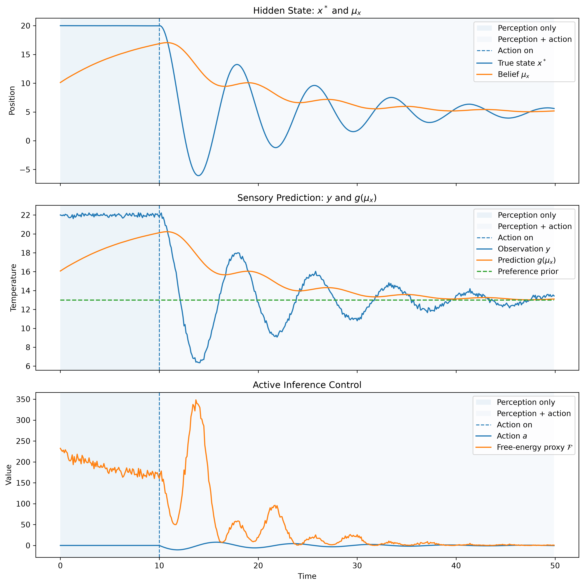
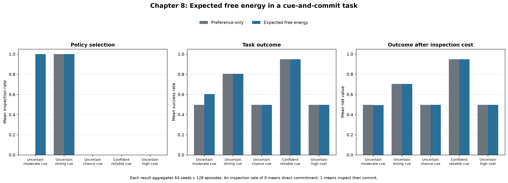

# AIFit

A reproducible Python implementation companion for selected Active Inference
concepts.

AIFit translates small, well-defined theoretical components into transparent
simulations, tested probability primitives, documented assumptions, and
versioned experimental results. The current work focuses on the relationship
between belief updating, action, uncertainty, and epistemic policy selection.

> **Question:** How can an agent use uncertain observations and preferences to
> decide whether to act directly or first gather information?

## Current scope

| Chapter | Status | Implementation |
| --- | --- | --- |
| 7 | Complete | Bayesian thermostat with perception, action, prediction errors, and a free-energy proxy |
| 8 | Complete | Discrete cue-and-commit task with preference-only and expected-free-energy policy planners |
| 9+ | Planned | Further policy-selection and learning extensions |

The repository is intentionally incremental: each chapter isolates a small
computational problem before introducing additional formal machinery.

## Chapter 7 — Bayesian thermostat

Chapter 7 implements an Active-Inference-inspired thermostat. The agent
maintains beliefs about a hidden temperature state, receives noisy
observations, updates its beliefs, and acts to move the environment toward a
preferred sensory state.

The implementation includes:

- a continuous hidden-state environment;
- Bayesian belief updates and prediction errors;
- an action-perception loop;
- configuration-driven, reproducible simulation; and
- tests for core agent, environment, and simulation behaviour.



This chapter is a transparent teaching model, not a full generalized-filtering
implementation of variational Active Inference.

## Chapter 8 — Expected free energy in a cue-and-commit task

Chapter 8 introduces a small discrete decision problem. An agent can commit
directly to a left or right option, or pay to inspect a noisy cue before
committing.

The benchmark compares:

- a **preference-only planner**, which selects the policy with the highest
  expected task outcome; and
- an **expected-free-energy planner**, which additionally assigns value to
  expected information gain.

The operational score is:

```text
expected preference value
+ epistemic weight × expected information gain
- inspection cost
```



### Benchmark result

The tracked benchmark aggregates 64 seeds with 128 episodes per seed.

- With an uncertain prior and a moderately informative cue, the
  preference-only planner commits directly, whereas the EFE planner inspects.
- Inspection raises mean success from 0.496 to 0.604 in that condition.
- After inspection cost, mean net value is 0.496 for the preference-only
  planner and 0.494 for the EFE planner.
- Both planners avoid inspection when the cue is uninformative, the prior is
  already confident, or inspection is expensive.
- When the cue is highly informative, inspection directly improves expected
  outcome, so both planners inspect.

The result is deliberately nuanced: epistemic behaviour can improve task
success without necessarily improving external reward after information costs
are included.

See [Chapter 8 notes](docs/chapter08.md) for the mathematical setup,
assumptions, references, and explicit non-claims.

## Reproduce

Requires Python 3.12 or later.

```bash
git clone https://github.com/vertu-al/AIFit.git
cd AIFit

python3 -m venv .venv
source .venv/bin/activate
python -m pip install --upgrade pip
python -m pip install -e ".[dev]"
```

Run quality checks:

```bash
python -m ruff check .
python -m pytest
```

Run the Chapter 7 simulation:

```bash
python -m aifit.simulation
```

Run and plot the Chapter 8 benchmark:

```bash
python scripts/run_chapter08_benchmark.py \
  --config configs/chapter08_benchmark.json \
  --output-dir results/chapter08

python scripts/plot_chapter08_results.py
```

## Repository structure

```text
AIFit/
├── configs/                  # Reproducible experiment configurations
├── docs/                     # Chapter notes, assumptions, and limitations
├── figures/                  # Chapter 7 tracked figure
├── notebooks/                # Executable chapter notebooks
├── results/                  # Versioned Chapter 8 outputs and figures
├── scripts/                  # Benchmark and plotting entry points
├── src/aifit/                # Package implementation
└── tests/                    # Unit and integration tests
```

## Design principles

- Make assumptions explicit.
- Keep mathematical operations inspectable.
- Separate reusable implementation from experiments and visualisation.
- Track configurations, outputs, and failure-relevant results.
- State limitations alongside results.

## Scope and non-claims

AIFit is not a production Active Inference framework, a full variational
inference engine, or evidence that biological agents optimize expected free
energy. It is a small, reproducible implementation project for studying
specific computational ideas under controlled assumptions.

## License

See [LICENSE](LICENSE) for licensing terms.